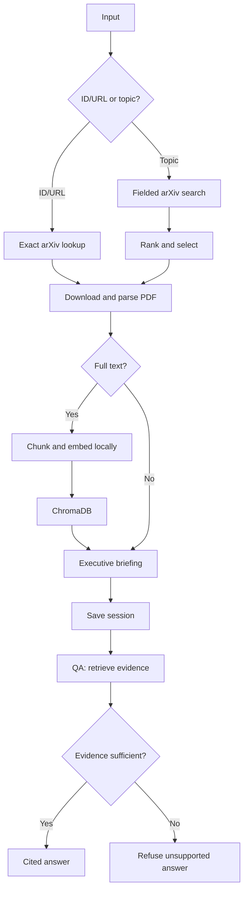

# Autonomous arXiv Paper Digest & QA Agent

A local-first Python agent that accepts an arXiv ID, URL, or research topic, creates a structured executive briefing for one paper, and answers follow-up questions only from retrieved paper evidence.

## Architecture



The LangGraph state contains normalized input, candidates, selected paper, parse result, chunks, vector collection name, briefing, question, retrieved evidence, chat history, warnings, and errors.

## Setup

Requirements: Python 3.11+ and Ollama.

```powershell
python -m venv .venv
.\.venv\Scripts\Activate.ps1
python -m pip install --upgrade pip
python -m pip install -e ".[dev]"
ollama pull qwen2.5:3b
```

If required, start the Ollama service in another terminal:

```powershell
ollama serve
```

Copy `.env.example` to `.env` only if you want to change local defaults. No API key is required.

## Usage

```powershell
arxiv-digest inspect "recent work on KV-cache compression for LLMs"
arxiv-digest digest "1706.03762"
arxiv-digest qa --session-id paper_1706_03762v7 "Which tasks were used for evaluation?"
```

`digest` prints the structured briefing and saves a local session. `qa` reloads that session, retrieves the closest chunks, and saves the updated conversation history.

## Verified example

The following was run locally with `qwen2.5:3b`, without an API key:

```powershell
arxiv-digest digest 1706.03762
# Session saved: paper_1706_03762v7

arxiv-digest qa --session-id paper_1706_03762v7 "Which translation tasks and datasets were used for evaluation?"
# Answer: WMT 2014 English-to-German and English-to-French.
# Citations: p. 8, "6.1 Machine Translation"; p. 7, "5.1 Training Data and Batching"

arxiv-digest qa --session-id paper_1706_03762v7 "What was the authors' office address?"
# I could not find sufficient evidence in the indexed content of this paper to answer that question.
```

The first question demonstrates cited retrieval. The second demonstrates the required refusal behavior.

## Grounding policy

The application, rather than the LLM alone, enforces grounding:

1. Retrieve top evidence chunks with local embeddings.
2. Reject weak retrieval by cosine-distance threshold.
3. Supply only retrieved chunks to the LLM.
4. Keep only citations whose chunk IDs match the retrieved evidence.
5. Refuse questions without sufficient, citable support.

## Failure behavior

| Situation | Behavior |
|---|---|
| Empty/unsupported input | Clear validation error |
| No topic candidates | Actionable graph error |
| Oversized/non-PDF download | Reject before finalizing the file |
| Broken/image-only PDF | Abstract-only briefing; no detailed QA |
| Weak QA evidence | Refuse rather than hallucinate |
| Ollama unavailable | Clear local setup error; no paid fallback |

## Design decisions and tradeoffs

- **LangGraph:** explicit nodes, edges, and shared state; more demonstrable than a hidden prompt chain.
- **PyMuPDF:** fast page-aware extraction for citations; difficult layouts may need OCR in production.
- **ChromaDB + sentence-transformers:** persistent semantic search without cloud credentials; first use downloads embedding weights.
- **Ollama:** free and local; requires model download and local compute.
- **One paper per session:** avoids ambiguous QA; multi-paper comparison is out of scope.
- **Deterministic ranking:** explainable title/abstract matching; future work could add embedding reranking.
- **Limitations are deterministic:** the app extracts author-caveat sentences (for example, "we plan ... future work") instead of allowing the model to infer weaknesses from omissions.

## Quality checks

```powershell
python -m pytest -q
python -m ruff check .
```

## Submission video and interview preparation

Use [docs/INTERVIEW_GUIDE.md](docs/INTERVIEW_GUIDE.md) for the end-to-end explanation, architecture walkthrough, likely interview questions, and a four-minute demo outline.

## License

MIT
